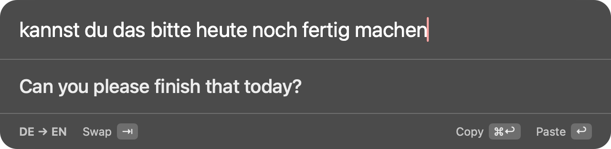

# Rüber

**Press a shortcut, type in your language, hit Enter: the English text lands where your cursor was.**



A tiny native macOS menu bar app. It uses Apple's on-device translation, so it is free, private and works offline. No account, no API key, no dependencies. (*rüber* is German for "across".)

## Install

Needs macOS 26 or later and Xcode 26.4 or later.

```bash
git clone https://github.com/ddkbs/rueber.git
cd rueber
./scripts/install.sh
```

This builds `Rüber.app`, copies it to `/Applications` and starts it. It launches at login; you can turn that off in the menu.

To paste automatically, click **Allow auto-paste…** in the panel and enable Rüber under *System Settings → Privacy & Security → Accessibility*. Without it, Enter only copies.

## Keys

| Key | Action |
| --- | --- |
| `⇧⌘Space` | Open or close (change it in the menu) |
| `↩` | Copy and paste into the app you came from |
| `⌘↩` | Copy only |
| `⇧↩` | New line |
| `⇥` | Swap direction |
| `esc` | Close and keep the draft |

Your language is taken from macOS. Pick another one under **My Language** in the menu.

## Good to know

- The translation is the only thing left on your clipboard; nothing is stored and nothing leaves your Mac.
- Line breaks, indentation and list markers stay as you typed them.
- With Apple's larger model it takes about half a second. If it is not installed, Rüber uses the smaller one and offers to download the language.
- Very repetitive text can make the larger model repeat itself.

There is also a command line mode:

```bash
"/Applications/Rüber.app/Contents/MacOS/Rueber" --translate "Bis gleich"
```

## Development

```bash
swift test          # unit tests
scripts/build.sh    # build/Rüber.app
```

`RueberCore` holds the logic (layout, debouncing, shortcuts) and is fully tested. `Rueber` is the thin AppKit/SwiftUI shell around it. `build.sh` signs with the first code signing certificate it finds; without one, macOS asks for the Accessibility permission again after every rebuild.

## License

[MIT](LICENSE)
